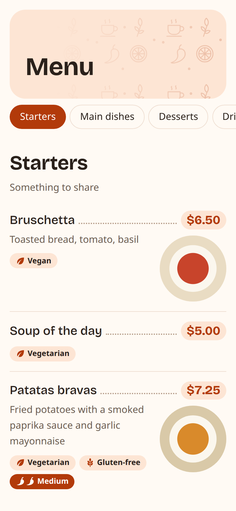
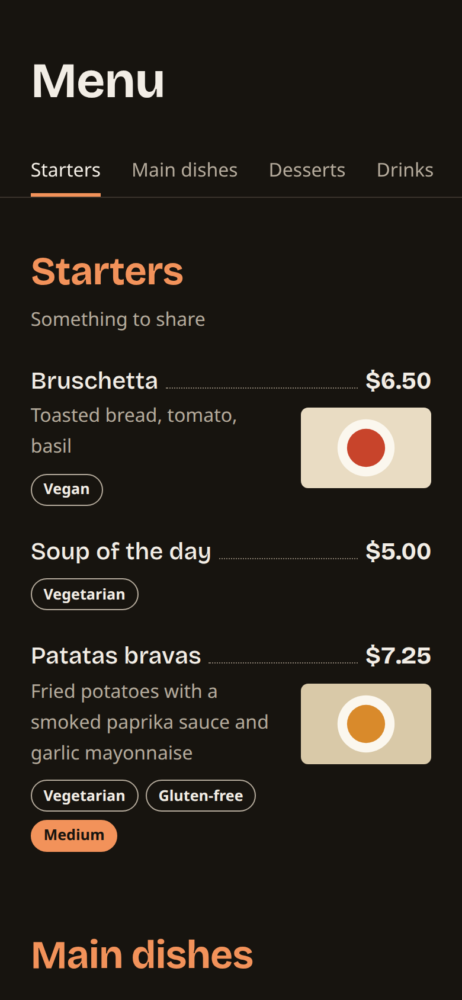

# decarta-site

The website that shows restaurant menus published with
[decarta-bot](https://github.com/luis-serrano-l/decarta-bot). A diner scans a
QR code or opens a link such as `/menu/3fK9…` and reads the menu on their
phone.

It is a [Hugo](https://gohugo.io/) site hosted on GitHub Pages, with one
stylesheet and one script. There is no framework and no build step other
than Hugo.

<p>
  
  
</p>

## How it pairs with the bot

1. A restaurant owner sends their menu to decarta-bot on Telegram.
2. The bot validates it and commits it to this repository as
   `static/menus/<id>.json`. The id is 16 to 32 base62 characters.
3. That push runs the Pages workflow, which rebuilds and deploys the site.
4. The bot gives the owner the link `/menu/<id>`.

No page is generated per menu. GitHub Pages serves `404.html` for any
unknown path and leaves the URL in the address bar, so `static/js/menu.js`
reads the id from the path, checks its shape, and fetches
`menus/<id>.json` from the site's own origin. Keep `layouts/404.html`:
without it, menu links stop working.

The file format is defined by the bot; see its
[menu schema](https://github.com/luis-serrano-l/decarta-bot/blob/main/docs/reference/menu-schema.md).
The site also shows two optional item fields the bot does not accept yet:
`dietary` (a text or a list of texts) and `spicy` (a text, a level from 1
to 3, or `true`).

## Local preview

You need Hugo 0.123 or later.

```bash
hugo server
```

Then open:

- <http://localhost:1313/menu/SampleMenu0000000> for a published menu,
  loaded from `static/menus/SampleMenu0000000.json`
- <http://localhost:1313/menu/NoSuchMenu0000000> for the "menu not found"
  state
- <http://localhost:1313/> for the sample restaurant in `data/menu.json`

`hugo server` answers unknown paths with `404.html`, as GitHub Pages does,
so menu links behave the same locally. To preview your own menu, save it as
`static/menus/<id>.json` with any id of 16 to 32 letters and digits.

To build as the workflow does:

```bash
hugo --config hugo.production.toml --minify
```

## Security

Menu files come from restaurant owners, so the site treats them as
untrusted:

- Menu text is written with `textContent` and elements are made with
  `createElement`. The script never uses `innerHTML`.
- An item image is used only if it is an `https://` URL or a path on this
  site that starts with `/`.
- The id is checked against `^[A-Za-z0-9]{16,32}$` before anything is
  fetched.
- Every page carries a Content-Security-Policy that allows scripts, styles,
  fonts and data only from this origin and has no inline scripts or styles.
  Keep it that way: new scripts go in `static/js/`, not in templates.

## Design

Styles are in `static/css/custom.css`. Spacing and type sizes are steps of
the golden ratio (1.618), defined once as custom properties at the top of
the file together with the colours for the light and dark themes. Use those
tokens instead of new literal values.

The markup for a menu exists twice and must stay in step:
`layouts/partials/menu.html` and `dish.html` render the sample restaurant
at build time, and `static/js/menu.js` builds the same elements for
published menus.

Headings use [Bricolage Grotesque](https://github.com/ateliertriay/bricolage),
served from `static/fonts/` under the SIL Open Font License.

## Layout of the repository

| Path | What it holds |
|---|---|
| `static/menus/` | Published menus, written by the bot. `SampleMenu0000000.json` is a fixture for previews. |
| `static/js/menu.js` | Loads and renders `/menu/<id>`; category navigation |
| `static/css/custom.css` | Design tokens and all styles |
| `layouts/404.html` | The page behind every `/menu/<id>` link |
| `layouts/partials/` | Build-time menu markup for the sample restaurant |
| `data/menu.json` | The sample restaurant shown on the home page |
| `hugo.toml`, `hugo.production.toml` | Local and Pages configuration, including `currencySymbol` |
| `.github/workflows/hugo.yml` | Builds and deploys on pushes that change the site, including `static/menus/` |

## Deployment

In the repository settings, set Pages to deploy from GitHub Actions. The
workflow then publishes the site at
<https://luis-serrano-l.github.io/decarta-site/> on every push to `main` that
touches the site's sources or `static/menus/`.

## License

See [LICENSE](LICENSE).
